# AVA Ghosts 'n Goblins

[](https://github.com/Harlock123/AVAGhostsNGoblins/actions/workflows/build.yml)

A run-and-throw platform game in the style of Capcom's 1985 arcade game **Ghosts 'n Goblins**, built with
.NET 10 and Avalonia UI. The demon Malgrim has carried off the Princess Elowen, and the knight Sir Hollin must
cross four stages of a haunted realm to save her. He throws lances, daggers, torches and axes at whatever
rises, flies or lurches at him. One hit takes his armour, leaving him in his undershirt and striped shorts.
The next hit takes him.

## Features

- **Four stages**, each ending in a fight with a boss and a key to the next:
  - **The Graveyard:** gravestones to jump and hide behind, zombies rising from the earth, crows, a
    spitting plant, a red gargoyle, and the **cyclops**.
  - **The Haunted Village:** cottages to leap onto, a loft up a ladder, waves of ghosts, ogres, and the
    **gargoyle lord**.
  - **The Frozen Caverns:** an icy roof, ledges gliding over the gaps, swooping bats, and the coiling
    **serpent**, whose head alone can be hurt.
  - **The Demon's Tower:** pits of fire, gargoyles, and **Malgrim** himself, flinging fans of fire and
    calling up bats.
- **Sir Hollin** walks, crouches and climbs ladders. His jump is a jump: its way across is fixed when it
  starts. A time limit runs on every stage, and a life lost past the halfway mark starts again from there.
- **The armour:** one hit knocks it off (and knocks him back); the next is the end. Armour found in a pot
  puts it back on.
- **Four weapons**, from the pots along the way. The **lance** flies true, two at a time. The **dagger** is
  quickest, three at a time. The **torch** arcs over and burns where it lands. The **axe** goes up and over,
  and through more than one foe. Gravestones stop them all.
- **The red gargoyle** hangs in the air, slips aside from a throw (but needs a moment before it can again),
  swoops, and spits fire. When a boss arrives, the lesser creatures flee: the end of a stage is a duel.
- **After Malgrim**, the realm comes round again, faster.
- **The attract mode** shows the computer knight at work. Every few steps it tries a handful of moves, each
  followed by a few ways on, on copies of the world, and takes the one that keeps it alive and gets it
  furthest.

## Screenshots

| The title | The graveyard | A jump |
|:---------:|:-------------:|:------:|
| 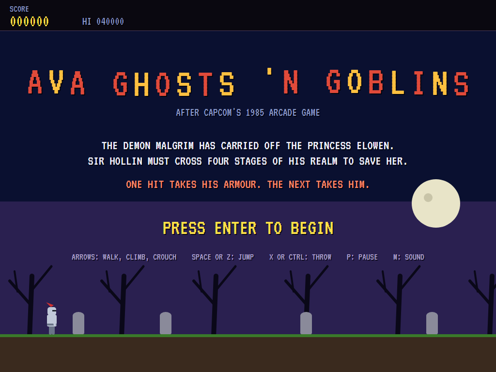 | 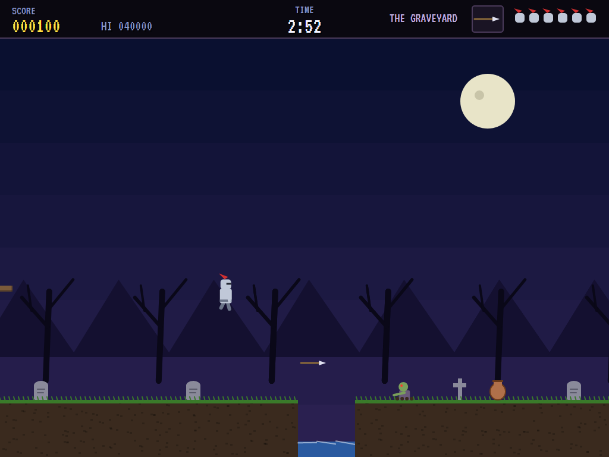 | 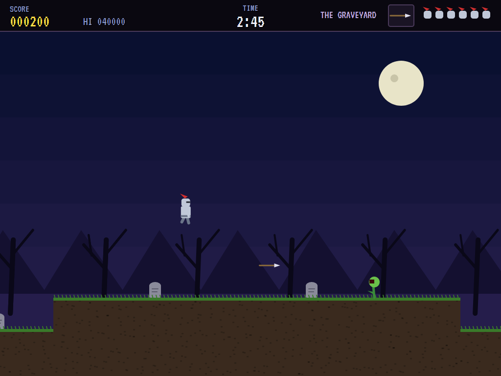 |
| Sir Hollin's errand. | Zombies rising. | Over the gravestones. |

| The cyclops | The village | A gargoyle |
|:-----------:|:-----------:|:----------:|
| 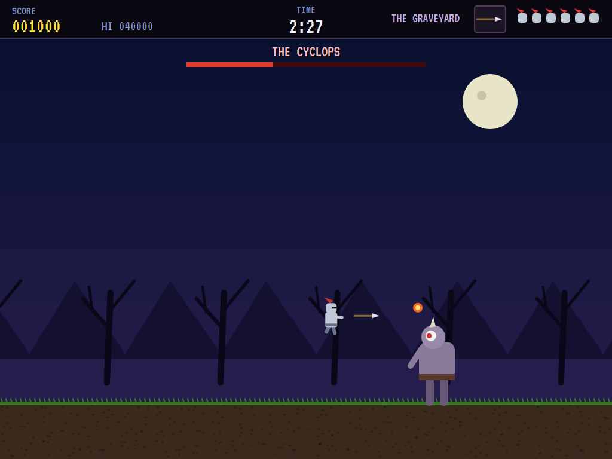 | 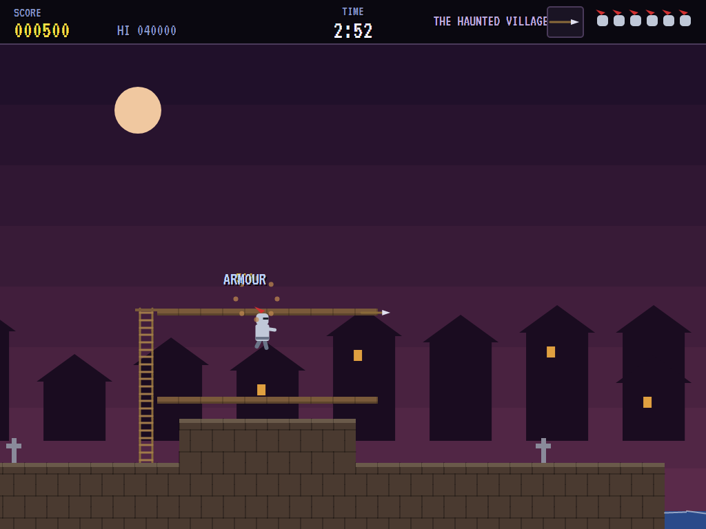 | 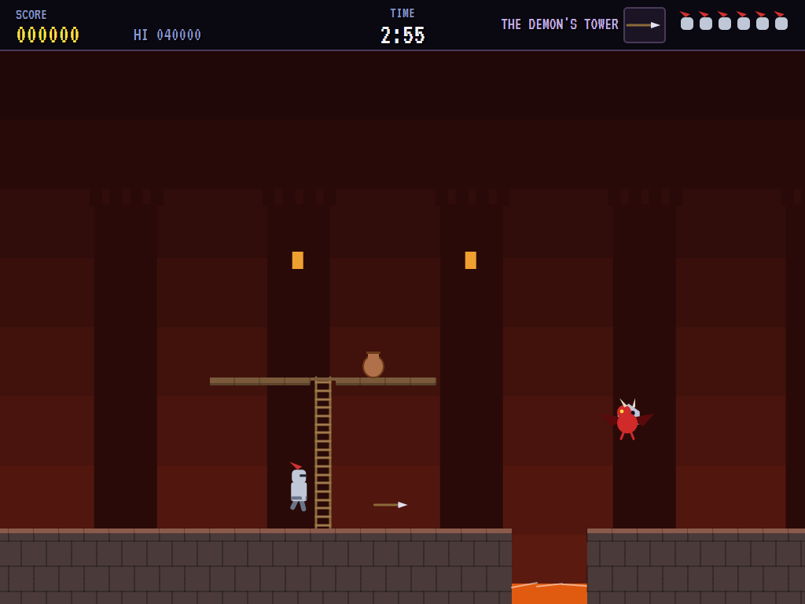 |
| It leaps. | Ghosts drifting through. | In the Demon's Tower. |

| The caverns | The serpent | Malgrim |
|:-----------:|:-----------:|:-------:|
| 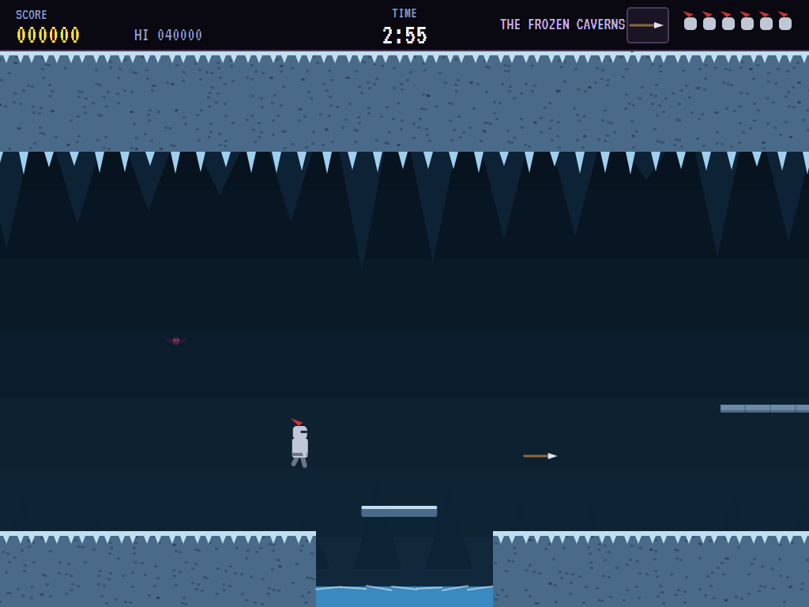 | 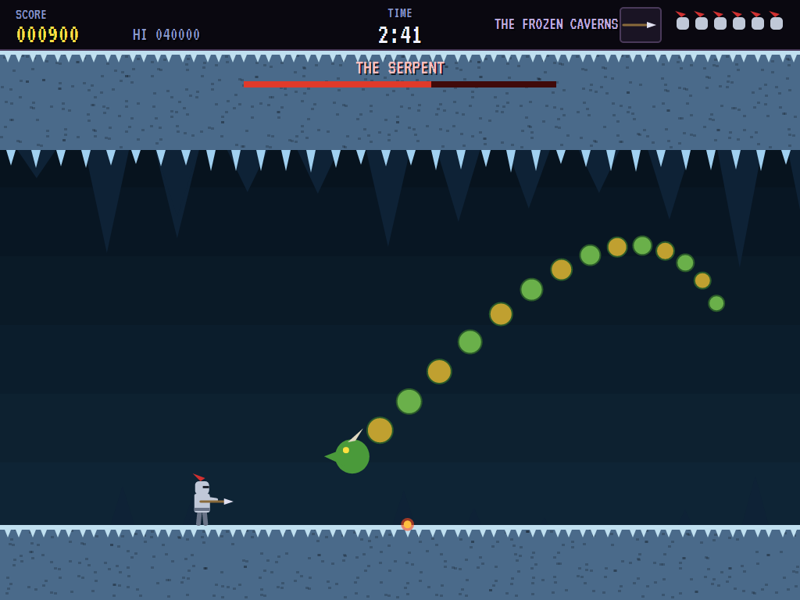 | 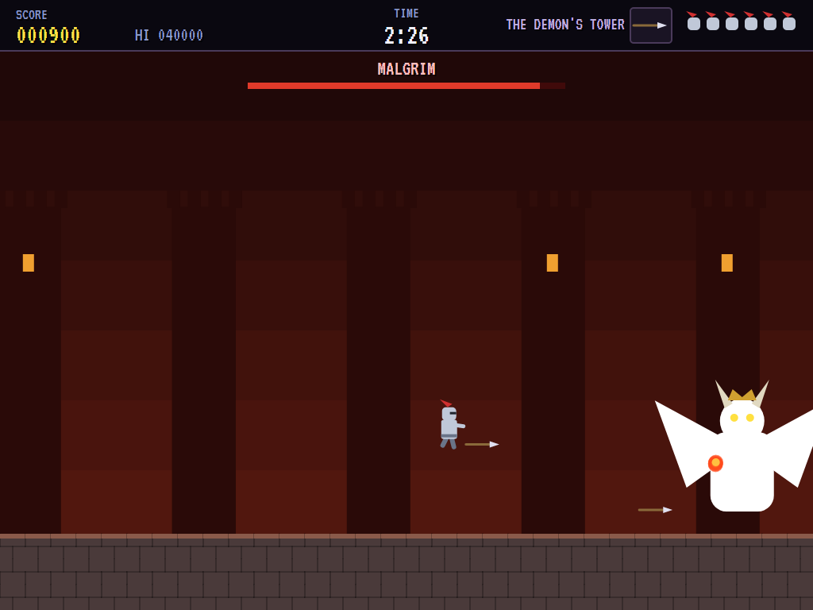 |
| A gliding ledge over the gap. | Only its head can be hurt. | Struck: he flashes. |

| No armour | Stage clear | The bravest knights |
|:---------:|:-----------:|:-------------------:|
| 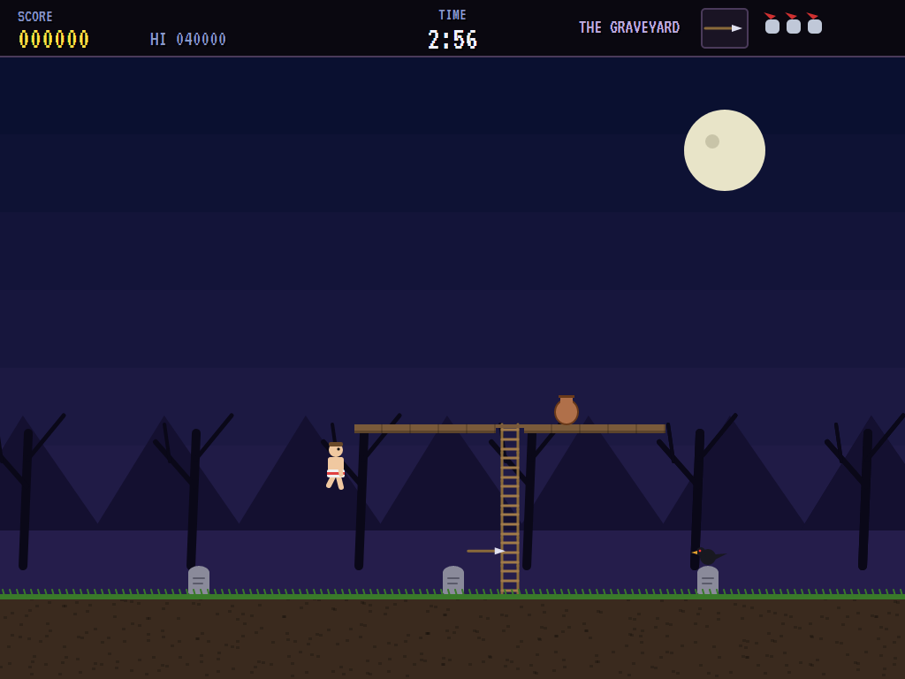 | 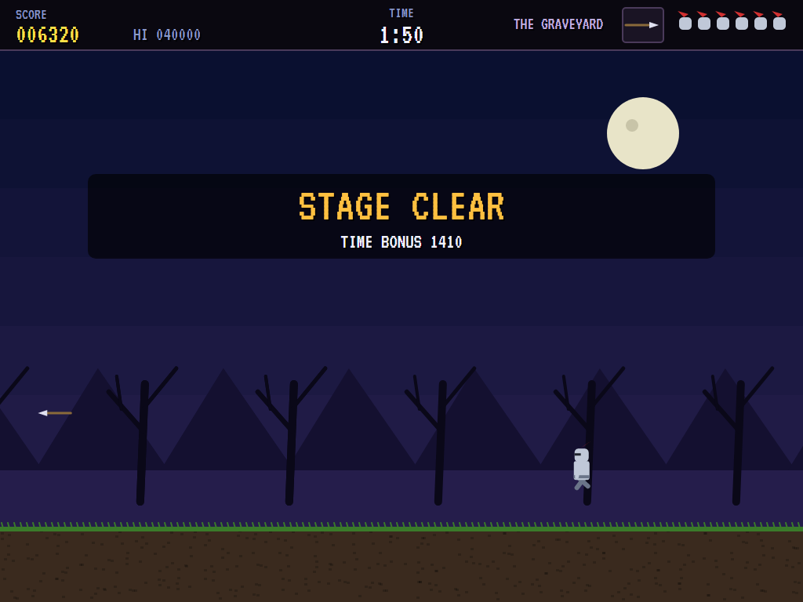 | 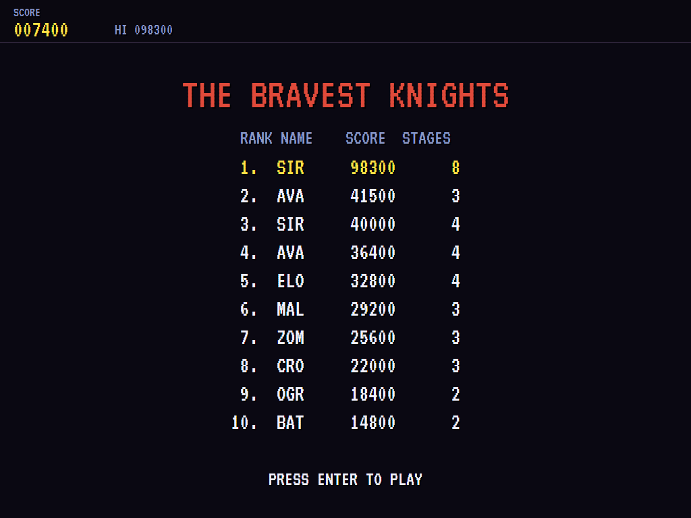 |
| One more hit. | The time left, counted. | The high-score table. |

The screenshots are made by the tests, which play the game in a real (headless) window; see
[Tests](#tests).

## Download and run

Ready-to-run builds for Windows, macOS and Linux, on both Intel/AMD and ARM, are on the
[Releases page](https://github.com/Harlock123/AVAGhostsNGoblins/releases/tag/latest). **Latest build** is
rebuilt on every push to `main`. Each download is one self-contained executable: no .NET install is
needed.

| Platform | Archive |
|---|---|
| Windows | `AVAGhostsNGoblins-win-x64.zip`, `AVAGhostsNGoblins-win-x86.zip`, `AVAGhostsNGoblins-win-arm64.zip` |
| macOS | `AVAGhostsNGoblins-osx-arm64.tar.gz` (Apple silicon), `AVAGhostsNGoblins-osx-x64.tar.gz` (Intel) |
| Linux | `AVAGhostsNGoblins-linux-x64.tar.gz`, `AVAGhostsNGoblins-linux-arm64.tar.gz`, `AVAGhostsNGoblins-linux-arm.tar.gz` |

```bash
tar -xzf AVAGhostsNGoblins-linux-x64.tar.gz     # or linux-arm64, linux-arm, osx-arm64, osx-x64
./AVAGhostsNGoblins
```

On Windows, unzip and run `AVAGhostsNGoblins.exe`. On macOS, if Gatekeeper refuses to open it, run
`xattr -d com.apple.quarantine AVAGhostsNGoblins` once. Run with `--no-audio` for silence.

**Sound** comes through OpenAL Soft, built in for every platform. In a virtual machine the game
detects it and uses a larger audio buffer, so the sound doesn't break up.

**Gamepads** use SDL2, which is bundled for Windows, macOS and Intel/AMD Linux. ARM Linux builds need it
installed; without it the keyboard still works:

```bash
sudo apt install libsdl2-dev            # Debian / Ubuntu / Raspberry Pi OS
sudo pacman -S --needed sdl2-compat     # Arch / Omarchy
```

## Controls

| Action | Keyboard | Gamepad |
|---|---|---|
| Start | Enter or 1 | Start |
| Walk | Left/right arrows or A/D | Left stick / D-pad |
| Climb a ladder | Up/down arrows or W/S | Up/down |
| Crouch | Down (or S) | Down |
| Jump | Space or Z | A |
| Throw | X, Ctrl or Shift | B, X or right trigger |
| Pause | P or Esc | Start or Back |
| Sound on/off | M | |
| Screenshot | Ctrl+S (to your Pictures folder) | |

On the high-score table, type your initials, or use up/down and Space, then Enter.

## Tests

```bash
dotnet test AVAGhostsNGoblins.slnx
```

The game runs in fixed 60 Hz steps, so it plays the same at any frame rate. Everything that moves lives in
one world that can be copied, and a copy plays out exactly as the world does (that's tested too). The tests
check:

- **The stages:** every step up on the main path can be jumped, and every gap without a gliding ledge is
  short enough to jump. The computer knight clears every stage (losing no more than two lives, in the
  stages where a hit can knock him back into a pit).
- **Moving about:** a gravestone stops him; a jump clears it, with its way across fixed when it starts; a
  pit kills, but one three squares wide can be jumped; up a ladder onto a ledge and down again; crouching.
- **Throwing:** lances two at a time and daggers three; a gravestone stops a throw; a lance brings down a
  zombie; a torch burns where it lands and an axe goes up and over; a pot broken gives up what's in it.
- **The armour:** the first hit takes it, with a moment's safety, and the next takes him; armour found puts
  it back on.
- **Creatures:** zombies rising, shambling on and sinking back; a crow taking off; a gargoyle slipping
  aside; the boss arriving as the rest flee, and beating it dropping the key.
- **The game:** out of time is death, and a life lost past the checkpoint starts again there; the last life
  and the high-score table; the key clearing the stage, with the time left as points; the demonstration and
  the high scores; the keys.

`tests/AVAGhostsNGoblins.Tests/PilotProbe.cs` reports how the computer knight gets on in each stage over
several games, for tuning (`GOBLINS_PROBE=1`; `GOBLINS_PROBE=lazy` for a knight who only walks on and
throws).

The screenshot tests draw the real screen in a headless window. To refresh the README's pictures:

```bash
GOBLINS_SHOTS=$PWD/Images dotnet test tests/AVAGhostsNGoblins.Tests --filter ScreenshotTests
```

## Building

```bash
dotnet build AVAGhostsNGoblins.slnx
dotnet run --project src/AVAGhostsNGoblins
```

Needs the .NET 10 SDK. The sounds and tunes are made by `tools/make_sounds.py` (standard-library Python):
`python3 tools/make_sounds.py` rewrites `src/AVAGhostsNGoblins/Sounds`.

## Project structure

```
AVAGhostsNGoblins/
├── AVAGhostsNGoblins.slnx
├── src/AVAGhostsNGoblins/
│   ├── Engine/
│   │   ├── GameEngine.cs        # States, lives, checkpoints, stages in turn, the title and demonstration
│   │   ├── Sim.cs               # A stage step by step: Sir Hollin, weapons, creatures, bosses, hits
│   │   ├── World.cs             # Everything that moves, kept together so it can be copied
│   │   ├── Stage.cs             # Squares, how a stage is built, and the four stages
│   │   ├── Pilot.cs             # The computer knight (the demonstration, and the tests)
│   │   ├── HighScoreTable.cs, InitialsEntry.cs
│   │   ├── InputHandler.cs, ControllerManager.cs  # Keys and an SDL2 gamepad
│   │   └── SoundManager.cs      # Effects, the march and the tunes through OpenAL
│   ├── Audio/                   # The OpenAL engine (from the author's AVABand)
│   ├── Views/                   # The drawing: the four stages, the knight, every creature and boss
│   └── Sounds/                  # The synthesised effects and tunes
├── tests/AVAGhostsNGoblins.Tests/  # Stage, gameplay and screenshot tests
├── tools/make_sounds.py
└── Images/                      # Screenshots
```

## About and licence

AVA Ghosts 'n Goblins © 2026 Lonnie Watson, under the [MIT License](LICENSE).

*Ghosts 'n Goblins* © 1985 Capcom; the name belongs to its current owner. AVA Ghosts 'n Goblins is an
independent, unofficial game in its style. Its knight, princess and demon, its stages, creatures and bosses,
its graphics, sounds, tunes and code are its own; nothing is taken from the original game's program,
graphics or sound. It is not affiliated with or endorsed by any rights holder.
